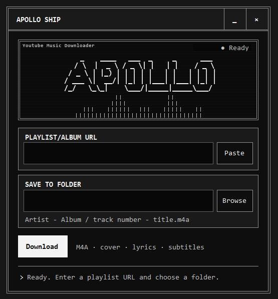
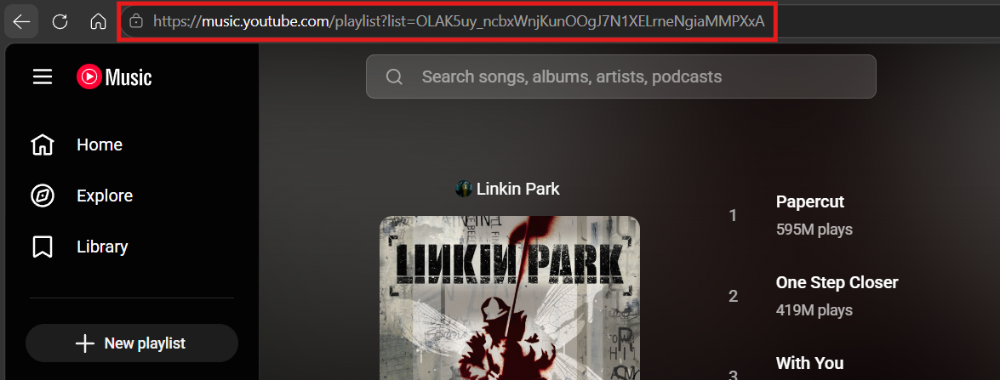

# Apollo Ship

**Apollo Ship** is a small Windows app that saves YouTube Music playlists and albums as local M4A files for listening in your own music player.


I use YouTube Premium, but sometimes I want to listen offline in Poweramp with my custom equalizer. I wanted the files for the player I already use, so I built a downloader instead of another music player. The fixed window and animated ASCII art bring back the feel of old keygen programs.



Apollo Ship accepts a playlist or album URL. It does not sign in to YouTube or use a Premium session; an external `yt-dlp.exe` handles the download.

## Disclaimer

I recommend buying music or streaming through YouTube Music to support the artists. Apollo Ship is a personal experiment for offline listening. If you enjoy an album, consider buying it digitally or on CD when you can.

## How it works

1. Enter a YouTube Music playlist or album URL and choose a destination folder.
2. `yt-dlp` downloads the audio as M4A, adds cover art and metadata, and writes playlist track numbers. If available, it saves English, Japanese, and Indonesian subtitles as separate SRT files.
3. Apollo Ship looks up each downloaded track on LRCLIB. When the title, artist, album, and duration match, it uses FFmpeg to embed plain lyrics in the M4A. A track without a match keeps its audio unchanged.
4. When processing finishes, the destination opens in File Explorer.

The window shows one-line progress and lets you stop a download. It has a fixed size, a dark theme, an animated ASCII GIF, and a looping sound while it is open. The GIF and sound are inside the EXE. The UI uses native Windows controls, so it does not need a browser runtime.

## Requirements

- Windows 10 or 11, x64, with .NET Framework 4.7 or newer.
- [`yt-dlp.exe`](https://github.com/yt-dlp/yt-dlp/releases), `ffmpeg.exe`, and `ffprobe.exe` from an [FFmpeg build](https://ffmpeg.org/download.html). The app looks beside its EXE first, then on `PATH`. FFmpeg and FFprobe must be in the same folder.
- Internet access for the playlist or album download and LRCLIB lyric lookup. For full YouTube support, yt-dlp also needs a supported JavaScript runtime; its [EJS setup guide](https://github.com/yt-dlp/yt-dlp/wiki/EJS) recommends Deno.

## Installation

1. Use the included [Windows EXE](dist/Apollo-Ship.exe), or [build it from source](#build-from-source).
2. Download the [Apollo tools ZIP](https://drive.google.com/file/d/1d2ydFRQ9A68X8yDcQGMgbGSh4733qyV0/view). It contains `yt-dlp.exe`, `ffmpeg.exe`, `ffprobe.exe`, and `ffplay.exe`. The app needs the first three; `ffplay.exe` is optional.
3. Extract the ZIP to a permanent folder, such as `C:\Tools\Apollo`. The EXE files should be directly inside that folder. Do not add the ZIP file itself to `PATH`.
4. In Windows, search for **Edit environment variables for your account**. Under **User variables**, select **Path** → **Edit** → **New**, add the folder containing the EXE files (for example, `C:\Tools\Apollo`), and confirm the dialogs. Open a new PowerShell window and check:

   ```powershell
   where.exe yt-dlp
   where.exe ffmpeg
   where.exe ffprobe
   ```

5. Set up a supported JavaScript runtime according to the [yt-dlp EJS guide](https://github.com/yt-dlp/yt-dlp/wiki/EJS) if it is not already available. The ZIP above does not include one.

You can also get yt-dlp and FFmpeg from the official links in [Requirements](#requirements). Apollo Ship checks beside its EXE first, then `PATH`; keep FFmpeg and FFprobe together whichever method you choose.

The app itself needs no account, API key, or configuration file. Both input fields start empty.

## Usage

From the repository root in PowerShell, start the desktop app:

```powershell
& ".\dist\Apollo-Ship.exe"
```

Open the playlist or album in YouTube Music and copy the full URL from your browser's address bar (outlined in red below).



1. Paste a YouTube Music playlist or album URL into **Playlist/Album URL**. The **Paste** button reads the clipboard.
2. Choose a destination with **Browse**, or type a folder path in **Save to folder**.
3. Select **Download**. The button changes to **Stop** while processing. The status line shortens long messages; hover over it to read the full text.
4. When download and lyric processing finish, File Explorer opens the destination folder. Look for M4A files under the uploader and album folders.

## Output structure

The output follows [command.txt](command.txt). Within the destination folder, the path is:

```text
<playlist uploader> - <album>\<track number> - <title>.m4a
```

The album can fall back to the playlist title, and a missing uploader can fall back to `Unknown Artist`. Subtitle SRT files stay separate from the audio. Embedded lyrics are plain text and depend on a reliable LRCLIB match; the presence or display of lyrics in a player is not guaranteed.

## Build from source

Run this from the repository root in PowerShell:

```powershell
.\build.cmd
```

The script uses the Windows .NET Framework compiler and FFmpeg on `PATH` to convert [assets/sound.ogg](assets/sound.ogg) into an embedded WAV resource. It embeds [assets/ascii.gif](assets/ascii.gif), adds [assets/icon.ico](assets/icon.ico) as the Windows application icon, creates one x64 EXE in `dist`, and fails if the EXE exceeds 1 MB. FFmpeg is needed to build the sound, but the finished EXE plays it without an external audio file or decoder. To regenerate the GIF and preview still image, run `python tools/ascii.py` with Pillow installed. To regenerate the ICO from [assets/icon.png](assets/icon.png), run `python tools/icon.py`.

There is no automated test suite in this repository. A successful build confirms compilation and the EXE size check; it does not test a live playlist or album download.

## Project structure

| Path | Purpose |
| --- | --- |
| [src/](src) | WinForms UI, downloader, manifest, and version metadata. |
| [assets/](assets) | Chiptune, pixel icon, and ASCII animation sources and build assets. |
| [preview/index.html](preview/index.html) | Standalone visual preview; the EXE does not load it. |
| [tools/](tools) | Scripts that regenerate the GIF, still image, and ICO. |
| [command.txt](command.txt) | Reference yt-dlp command and output naming. |
| [build.cmd](build.cmd) | Compiles the EXE and checks its size. |

## Credits and assets

I made the animated ASCII artwork, drew the pixel icon, and created the looping chiptune for Apollo Ship. The chiptune is a happy variation on the chords of **“Mosi Tidak Percaya” by Efek Rumah Kaca**.

Apollo Ship uses [yt-dlp](https://github.com/yt-dlp/yt-dlp) as its external download tool. Credit for yt-dlp goes to its contributors; it is installed separately and is not bundled in the EXE.

## Troubleshooting

### yt-dlp, FFmpeg, or FFprobe not found

**Cause:** Apollo Ship cannot find one or more of the required EXEs beside the app or on `PATH`.

**Solution:**

- Put `yt-dlp.exe`, `ffmpeg.exe`, and `ffprobe.exe` beside `Apollo-Ship.exe`, or add their folder to `PATH` as described in [Installation](#installation).
- Restart Apollo Ship after changing `PATH`.

### FFmpeg and FFprobe are in different folders

**Cause:** Apollo Ship found `ffmpeg.exe` and `ffprobe.exe` in different folders.

**Solution:** Put both EXEs in the same folder, then retry.

### YouTube JavaScript challenge

**Cause:** yt-dlp could not complete the challenge with the installed JavaScript runtime or solver components.

**Solution:** Follow the [yt-dlp EJS setup guide](https://github.com/yt-dlp/yt-dlp/wiki/EJS) to set up a supported runtime and solver, then retry.

### Music downloads, but lyrics are missing

**Cause:** LRCLIB found no close match, embedding failed, or your player does not show plain lyrics stored in M4A metadata. SRT subtitles are separate files.

**Solution:**

- Check the final status for **No LRCLIB match** or **Failed**.
- If lyrics were added but do not appear, check whether your player supports plain lyrics in M4A files.
